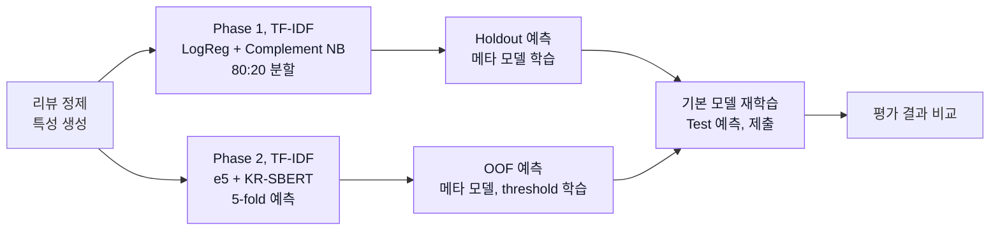

# Korean Sentiment Generalization

## Overview

한국어 영화 리뷰 감성 분류에서 **Public, Hidden 평가 성능의 차이**와 **문장 임베딩 결합 효과**를 비교한 개인 프로젝트.

- **Phase 1:** TF-IDF 기반 stacking 구성과 Public, Hidden 성능 비교
- **Phase 2:** 문장 임베딩과 5-fold OOF 예측을 추가한 확장 실험

   

## Data

| Item | Details |
|---|---|
| Source | NSMC 계열 한국어 영화 리뷰 과제 데이터 |
| Train | **149,995건**, 긍정, 부정 비율 약 49.9%, 50.1% |
| Test | **49,997건**, 정답 라벨 미공개 |
| Task | 긍정, 부정 이진 분류 |
| Metric | **MCC** — 예측과 실제 라벨의 일치도를 평가하는 상관계수 |

원자료는 저장소에 미포함. 과제용 파일 구성과 접근 조건은 [Data 안내](data/README.md) 참조.

## Research Design

- **1. 리뷰를 수치로 변환:** 텍스트 정제 후 형태소, 문자, 감성 표현을 TF-IDF로 변환. 리뷰 안의 표현과 빈도를 분류 모델의 입력으로 사용
- **2. TF-IDF 모델 구성 — Phase 1:** Logistic Regression과 Complement NB로 긍정, 부정 확률 예측. 학습 데이터를 80:20으로 나눠 기본 모델 학습과 메타 모델 입력 생성에 사용
- **3. 문장 임베딩 추가 — Phase 2:** multilingual-e5와 KR-SBERT로 문장의 의미를 수치 벡터로 변환하고 각각 분류 모델 학습. Word, Char TF-IDF 모델과 함께 5-fold 예측 생성
- **4. 예측 결합:** 기본 모델의 예측 확률과 리뷰 길이, 부정어 등의 특성을 Logistic Regression 메타 모델에 입력하는 **stacking** 적용. Phase 2에서는 각 표본을 학습하지 않은 fold의 예측값인 **OOF**를 메타 모델 학습에 사용
- **5. 결과 비교:** Phase 1은 Public, Hidden 점수와 순위 비교. Phase 2는 동일 Hidden 평가셋에서 TF-IDF 기준 모델과 임베딩 결합 모델의 **MCC** 비교

## Analysis Workflow



## Key Results

### Public vs. Hidden

- Phase 1 제출 모델의 **Public MCC 0.757, 5위 → Hidden MCC 0.7522, 9위**로 변화
- Public, Hidden 간 성능과 순위 차이 관찰. 단일 제출 결과이므로 다른 데이터에 대한 일반화 수준까지 판단하기는 어려움

<p align="center">
  
</p>
<p align="center"><sub>Phase 1의 서로 다른 평가 구간에서 측정한 MCC와 순위.</sub></p>

### Sparse vs. Dense

- Phase 2의 **동일 Hidden 평가셋**에서 TF-IDF 기준 모델 **0.665278 → 임베딩 결합 모델 0.753970**, MCC **+0.088692**
- 확장 모델의 최종 순위 **3 / 18**. 임베딩 추가와 검증 방식 변경을 함께 적용한 결과

<p align="center">
  
</p>
<p align="center"><sub>Phase 2의 TF-IDF 기준 모델과 확장 모델 비교. Phase 1 최종 점수 0.7522와는 평가셋이 다름.</sub></p>

| Evaluation | Model | Hidden MCC | Rank |
|---|---|---|---|
| Phase 1 | TF-IDF stacking | **0.7522** | **9 / 19** |
| Phase 2 | TF-IDF 기준 모델 | 0.665278 | — |
| Phase 2 | TF-IDF + e5 + KR-SBERT stacking | **0.753970** | **3 / 18** |

전체 실험 기록은 [Results](results/README.md) 참조.

## Limitations

- **평가셋 차이:** Phase 1, 2 점수와 순위를 직접 비교해 개선폭으로 해석할 수 없음
- **비교 범위:** Phase 2는 표현, 검증 방식을 함께 변경했으므로 임베딩만의 효과를 분리하지 못함
- **검증 범위:** 메타 모델 학습, threshold 탐색에 같은 메타 학습 표본 사용. 독립된 메타 OOF 평가는 미수행
- **불확실성:** 점수 차이의 신뢰구간, 통계적 유의성 평가 미수행

## Repository Structure

```text
├── notebooks/   # Phase 1, 2 분석 코드와 실행 안내
├── results/     # 실험 기록과 결과표
├── figures/     # 결과 그림
├── docs/        # 방법론과 상세 실험 문서
└── data/        # 데이터 배치 안내
```

[Notebooks](notebooks/README.md), [Results](results/README.md), [Figures](figures/README.md), [Docs](docs/README.md)

